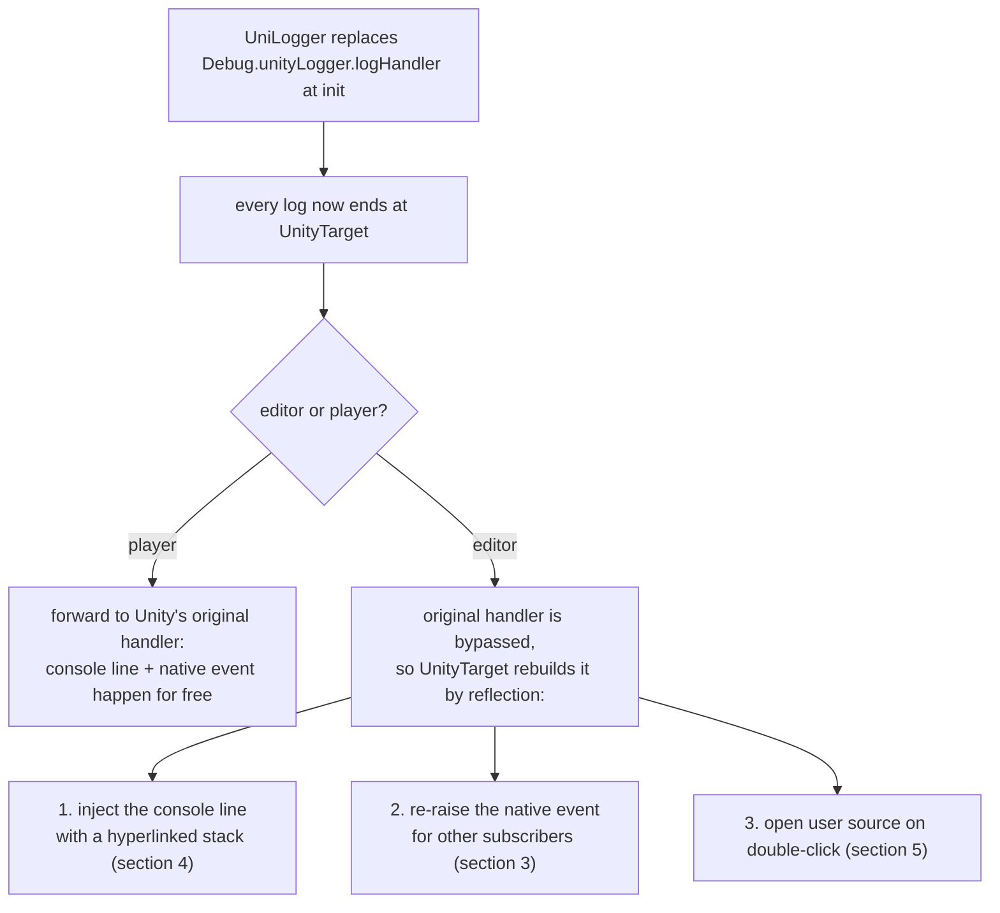
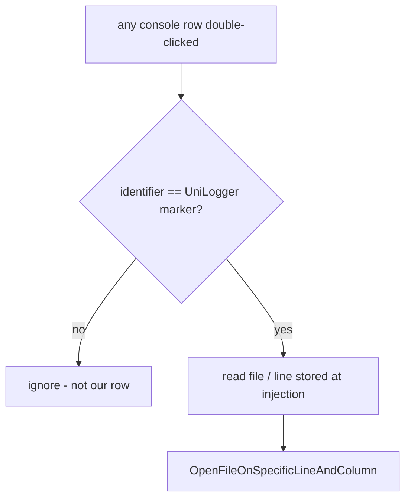

# UniLogger - Editor Reflection

This document describes how UniLogger reaches into Unity Editor internals through reflection: what it
touches, why, and where the code lives. Every box in the diagrams maps to real code.

Reflection is only needed in the editor. The whole feature is behind `#if UNITY_EDITOR`, so a player
build never sees it.

---

## Table of contents

1. [Why reflection](#1-why-reflection)
2. [`EditorReflection`: one place to resolve](#2-editorreflection-one-place-to-resolve)
3. [Native log callback](#3-native-log-callback)
4. [Console entry injection](#4-console-entry-injection)
5. [Double-click to open file](#5-double-click-to-open-file)
6. [Warmup and lifecycle](#6-warmup-and-lifecycle)

---

## 1. Why reflection

At init, UniLogger **replaces** Unity's log handler (`Debug.unityLogger.logHandler`), so every log now
ends at `UnityTarget` instead of Unity's default handler. But that default handler used to do three
things for free, and all three only happen in the editor:

1. draw the log line in the Console window,
2. fire the native log event (`Application.logMessageReceived*`),
3. open the source file when a line is double-clicked.

By taking the handler's place, UniLogger stops those from happening on their own, so it has to rebuild
each one. The Unity types and methods that do them are internal, not public - hence reflection. (It
cannot just call `Debug.Log` to redraw the line, because that would re-enter its own handler and loop;
see [section 4](#4-console-entry-injection).)

Rebuilding also gives more than the default handler did: full control of the line text (clickable
stack frames), a clean stack with no UniLogger noise, and a double-click that lands on user code.
All the reflection needed for the three parts is resolved in one class, `EditorReflection`.

---

## 2. `EditorReflection`: one place to resolve

Every internal Unity member the three features need is looked up in one place,
[`EditorReflection`](../src/Runtime/Targets/Unity/EditorReflection.cs), once per domain load. The two
bridge classes never *resolve* reflection themselves; they only invoke the members `EditorReflection`
already resolved.

The lookups are grouped by feature - native callback, console entry, double-click - and each group has
a capability flag (`CanRaiseNativeLog`, `CanInjectConsoleEntries`, `CanRegisterDoubleClick`). This
grouping is the point of the design: these are unsupported internal APIs, and a future Unity version
can rename or drop any one of them. When that happens only that group's flag goes `false` and the one
matching feature turns off, while the other two keep working. A bridge always checks the flag before
using a member.

Types are found by full name across every loaded assembly, not through a fixed assembly reference,
because the internal types (`LogEntries`, `LogEntry`, `ConsoleWindow`) have moved between editor
assemblies across Unity versions.

---

## 3. Native log callback

`UnityEngine.Application.CallLogCallback(message, stackTrace, LogType, onMainThread)` is the internal
method that raises Unity's native log events. The last argument says whether the call is on the main
thread; Unity uses it to decide whether to raise the main-thread-only `logMessageReceived` on top of
the always-raised `logMessageReceivedThreaded`. UniLogger passes the real value: `true` on the main
thread, `false` from a worker thread.

**Why this is needed.** Other code in the project may subscribe to `Application.logMessageReceived` /
`logMessageReceivedThreaded` - an in-game console, a crash reporter, an analytics hook. Injecting a
row into the editor console (section 4) does **not** raise those events; only Unity's own handler
would. Since UniLogger replaced that handler, it has to raise the event itself, or those subscribers
would never see any log. In an ideal world every such consumer would be a UniLogger target, but in
real projects that is not always possible, so UniLogger keeps feeding the native pipeline.

This re-raise happens only on the editor console path. In a player, and on the editor fallback path
(console reflection unavailable, see section 4), the log goes through Unity's original handler, which
raises the event on its own - so the two are never doubled. The re-raised event also flows back into UniLogger's own native listener; a recursion
guard (`ReentrancyCounter`) stops the loop, described in
[logging-pipeline.md](logging-pipeline.md#6-recursion-guard-and-the-native-feedback-loop).

---

## 4. Console entry injection

A Console row is not text - it is a `UnityEditor.LogEntry` object in an internal list. UniLogger
creates one, fills its fields, and appends it with `LogEntries.AddMessageWithDoubleClickCallback`.
Unity infers nothing about the row: whatever UniLogger writes into the fields is exactly what the
Console shows and what a later double-click acts on.

Direct injection instead of `Debug.Log` is a deliberate choice, for two reasons. First, `Debug.Log`
goes through the log handler UniLogger just replaced, so it would come straight back into the pipeline
and loop. Second, a raw `LogEntry` gives control the public API cannot:

- **`message`** holds the final text, including a stack where every `(at file:line)` frame is turned
  into a clickable console link. `Debug.Log` would make only the top frame clickable.
- **`mode`** carries the severity bits (error / warning / log) that choose the row icon.
- **`file` / `line`** store the double-click target, taken from the top frame of the already-cleaned
  stack - that is, the first *user* frame - so the jump lands on the caller's code, never on a
  UniLogger frame (`column` is always 0).
- **`identifier`** is a fixed marker (`0x754C4F47`, ASCII `uLOG`) that stamps the row as UniLogger's.
  The double-click handler uses it to tell our rows from every other row (section 5).

`LogEntries` is main-thread only, so a log raised on a worker thread cannot inject directly; it is
queued and flushed on the next `EditorApplication.update`. If the console reflection is unavailable
(older or newer Unity), injection is skipped and the log falls back to the original handler, so
nothing is lost. The behavior lives in
[`UnityConsoleBridge`](../src/Runtime/Targets/Unity/UnityConsoleBridge.cs).

---

## 5. Double-click to open file

An injected `LogEntry` is a bare object: it does not carry the internal callstack metadata that
Unity's built-in double-click uses to find a source line. A default double-click on a UniLogger row
would therefore jump nowhere useful. So UniLogger subscribes its own handler to the console's
`entryWithManagedCallbackDoubleClicked` event and resolves the source itself.

The handler fires for **every** row in the Console, so the marker check comes first: it is the only
way to tell a UniLogger row from any other, since the reused `OpenFileOnSpecificLineAndColumn` would
otherwise try to open the file of unrelated entries too.

---

## 6. Warmup and lifecycle

All resolved members live in static fields, which a domain reload wipes. So the setup has to run
again after every reload, and [`UnityConsoleBridgeInstaller`](../src/Editor/UnityConsoleBridgeInstaller.cs)
does it from `[InitializeOnLoadMethod]`. It resolves the reflection up front - warmup - so the first
real log does not pay the lookup cost, registers the double-click handler, and hooks the worker-thread
queue drain to `EditorApplication.update`. Rebuilding on each load also means the cache always matches
the assemblies the current Unity version actually loaded.
