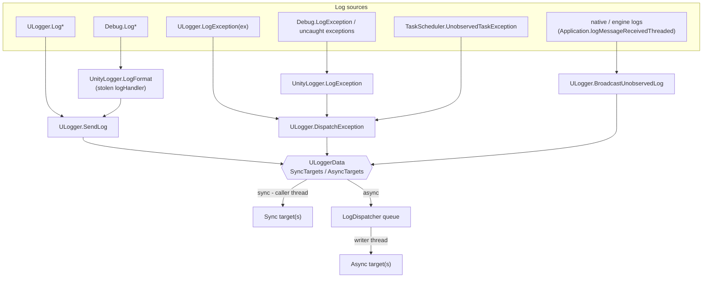
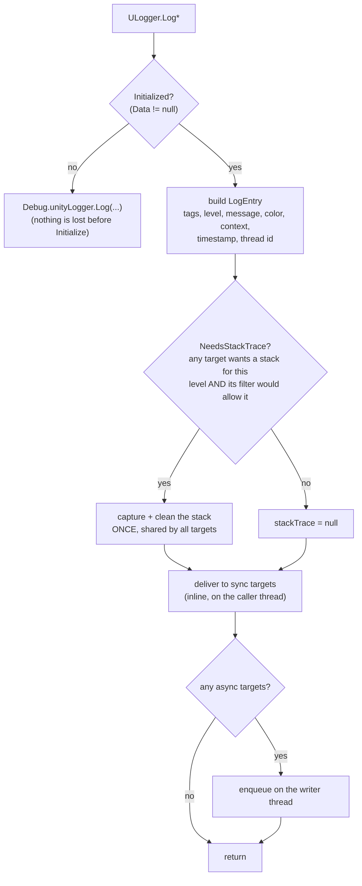
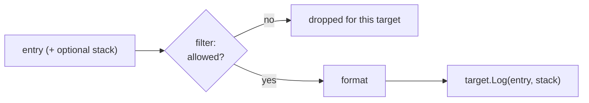
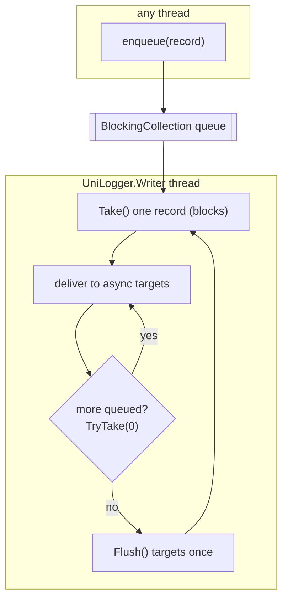
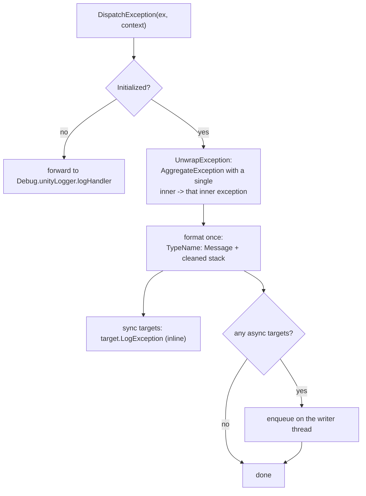
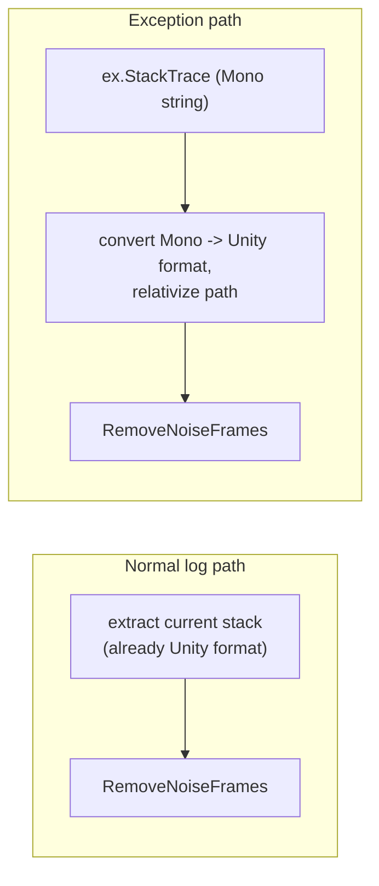
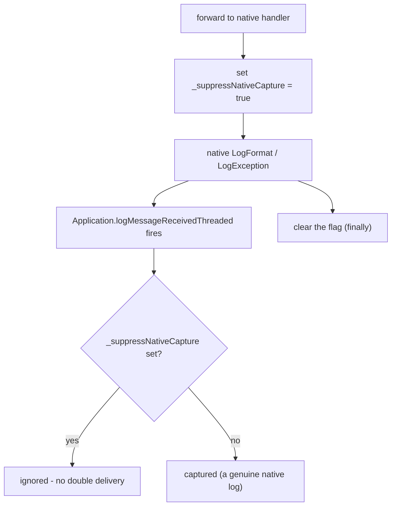

# UniLogger - Log Processing Pipeline

**Scope:** the life of a single log - from the call that creates it to the moment it reaches a
target's `Log` / `LogException`. This document deliberately stops at the target boundary.

**Out of scope** (separate documents):

- Built-in targets and how each one renders or stores a log - [`targets.md`](targets.md)
- `Formatter` and `Filterer` details (options, tag colors, level/tag rules) - [`formatting-and-filtering.md`](formatting-and-filtering.md)
- Logger lifecycle (`Initialize` / `Terminate`, play mode, handler steal) - [`logger-lifecycle.md`](logger-lifecycle.md)

---

## Table of contents

1. [Big picture](#1-big-picture)
2. [Entry points](#2-entry-points)
3. [The core: `SendLog`](#3-the-core-sendlog)
4. [Reaching a target: filter then format](#4-reaching-a-target-filter-then-format)
5. [Sync vs async and the writer thread](#5-sync-vs-async-and-the-writer-thread)
6. [Exceptions](#6-exceptions)
7. [Stack-trace handling](#7-stack-trace-handling)
8. [Recursion guard and the native feedback loop](#8-recursion-guard-and-the-native-feedback-loop)

---

## 1. Big picture

UniLogger **steals** `Debug.unityLogger.logHandler` at `Initialize()`. From that moment every managed
`Debug.Log*` / `Debug.LogException` in the whole project is routed into the same pipeline as
first-class `ULogger` calls. There is no round-trip through Unity just to grab a call stack:
UniLogger captures and cleans the stack itself.

Every log ends up in one of two lanes. A target declares whether it runs synchronously
(`RunSynchronously`); **sync** targets are delivered inline on the calling thread, **async** targets
are handed to a single background writer thread. The pipeline's job ends when it calls the target.



---

## 2. Entry points

Everything funnels into one of three core methods: `SendLog` (normal logs), `DispatchException`
(exceptions), and `BroadcastUnobservedLog` (native logs that bypassed our handler).

| # | Trigger | Reaches core via | Notes |
| --- | --- | --- | --- |
| 1 | `ULogger.Log*` | `ULogger.SendLog` | Compiled out entirely when the level is disabled (`[Conditional]`) |
| 2 | `ULogger.LogException(ex)` | `ULogger.DispatchException` | Tags are dropped for exceptions |
| 3 | `Debug.Log*` | `UnityLogger.LogFormat` -> `SendLog` | Tagged `Unsorted` |
| 4 | `Debug.LogException`, uncaught exceptions | `UnityLogger.LogException` -> `DispatchException` | |
| 5 | `TaskScheduler.UnobservedTaskException` | `OnUnobservedTaskException` -> `DispatchException` | Fires on GC finalization |
| 6 | native / engine logs (`Application.logMessageReceivedThreaded`) | `OnLogMessageReceivedThreaded` -> `BroadcastUnobservedLog` | Only catches logs that reached **native** without passing our handler; skips `Exception` type and suppressed forwards; delivered to every target that captures native logs (a target may opt out, see [`targets.md`](targets.md)) |

Entry point 6 is the safety net for logs originating in native/engine code, which never go through
the managed `logHandler`.

---

## 3. The core: `SendLog`

`SendLog` is the hot path for normal logs.



Key points:

- **The stack is captured at most once**, and only if some target actually needs it for this level.
  The captured string is shared across all targets (a target can still opt out per level).
- **Sync targets run inline** on the thread that called the log. This keeps a main-thread log on the
  main thread through to its target.
- **Async targets get a copy of the entry** pushed onto the dispatcher queue.

---

## 4. Reaching a target: filter then format

Both the inline sync path and the async writer thread hand each normal log to a target the same way:
the target's own **filter** decides pass/drop, then its **formatter** turns the entry into the final
string, then `target.Log` is called.



Filter and formatter are **per target**, so the same log can look different (or be dropped) in one
target and not another. The rules and formatting options are described in
[`formatting-and-filtering.md`](formatting-and-filtering.md).

---

## 5. Sync vs async and the writer thread

Which lane a target uses is a property of the target (`RunSynchronously`); the pipeline only cares
about the split. Sync targets are delivered inline on the calling thread. Async targets are queued
and drained by a single background writer thread:



- One record is taken (blocking), then the queue is **drained in a tight loop** and targets are
  flushed once per batch - good throughput without a per-line flush.
- On shutdown the queue stops accepting, the writer drains what remains and flushes a final time, so
  nothing queued is lost.

---

## 6. Exceptions

Exceptions take a separate route. They are unwrapped, formatted **once** into a single string
(type + message + cleaned stack), and delivered straight to `target.LogException` - **bypassing the
per-target filter and formatter** (an exception is a raw event and carries no tags).



Building the exception string (`TypeName: Message`, then the stack) is where the two stack sources
diverge: a present `Exception.StackTrace` (Mono format) is converted, otherwise the current stack is
extracted. Either way it is run through the noise filter. See [next section](#7-stack-trace-handling).

---

## 7. Stack-trace handling

Two independent components shape stacks. Which run depends on the path.



### Noise filtering - `RemoveNoiseFrames`

Strips whole stack lines whose start matches a known prefix at a frame boundary
(`. : ( space / +`). Prefixes are grouped so filters are easy to add or remove:

| Group | Removes frames from |
| --- | --- |
| UniLogger internals | `ULogger`, `ExtendedULogger`, `UnityTarget`, `UnityConsoleBridge`, `UnityExceptionFormatter`, `LogDispatcher` |
| Unity logging | `UnityEngine.StackTraceUtility`, `Debug`, `Logger`, `UnityLogger` |
| Assertions | `UnityEngine.Assertions` |
| Async machinery | `AsyncMethodBuilderCore`, `System.Threading`, `UnitySynchronizationContext` |

The boundary check prevents false positives: a user type like `Appegy.UniLogger.ULoggerFoo` is
**not** stripped, because the char after `ULogger` (`F`) is not a boundary.

### Mono -> Unity conversion (exceptions only)

`Exception.StackTrace` is a Mono-format string. `new StackTrace(exception)` would lose the original
throw site across `await`, so the converter parses the string instead:

```
  at NS.Type.Method (args) [0x00000] in /proj/Assets/Foo.cs:23
        becomes
NS.Type:Method (args) (at Assets/Foo.cs:23)
```

The path is relativized against the project root; frames outside the project keep their method but
drop the (unusable) location. In a build the embedded source paths do not match the device, so
exception locations are dropped there - expected.

---

## 8. Recursion guard and the native feedback loop

The pipeline may end up calling the **native** `Debug` handler (a target's fallback path, or the
raw-exception forward). That native write fires `Application.logMessageReceivedThreaded`, which we are
subscribed to for entry point 6 - so without a guard, a forwarded log would bounce right back into
the async targets a second time.

`_suppressNativeCapture` (a `[ThreadStatic]` flag) closes the loop:



The set/clear pair is wrapped in `try/finally`, so the flag can never get stuck, and it is
`[ThreadStatic]`, so it cannot leak between threads. In the **editor** the normal console path writes
directly to the editor console (never touches native), so the loop only arises on the native-forward
path (mainly the player).
