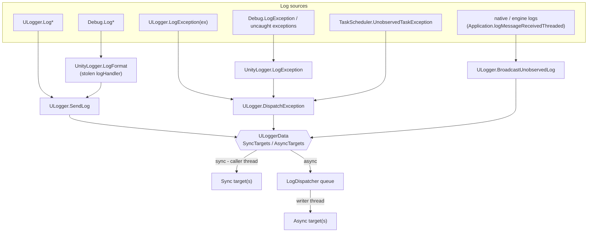
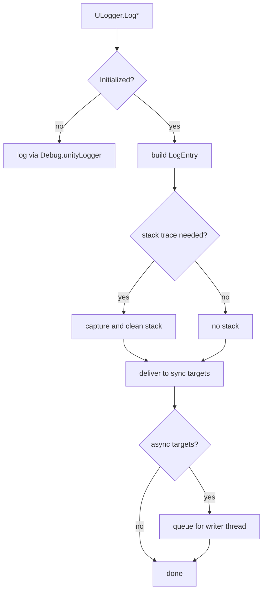
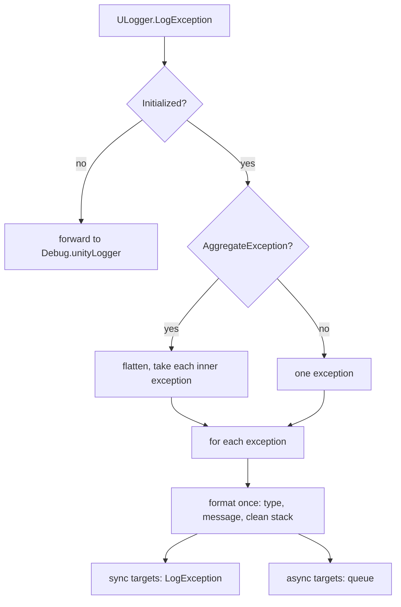
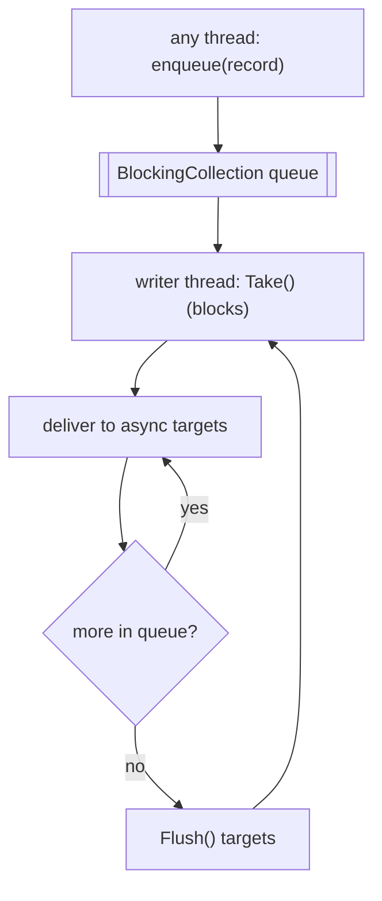
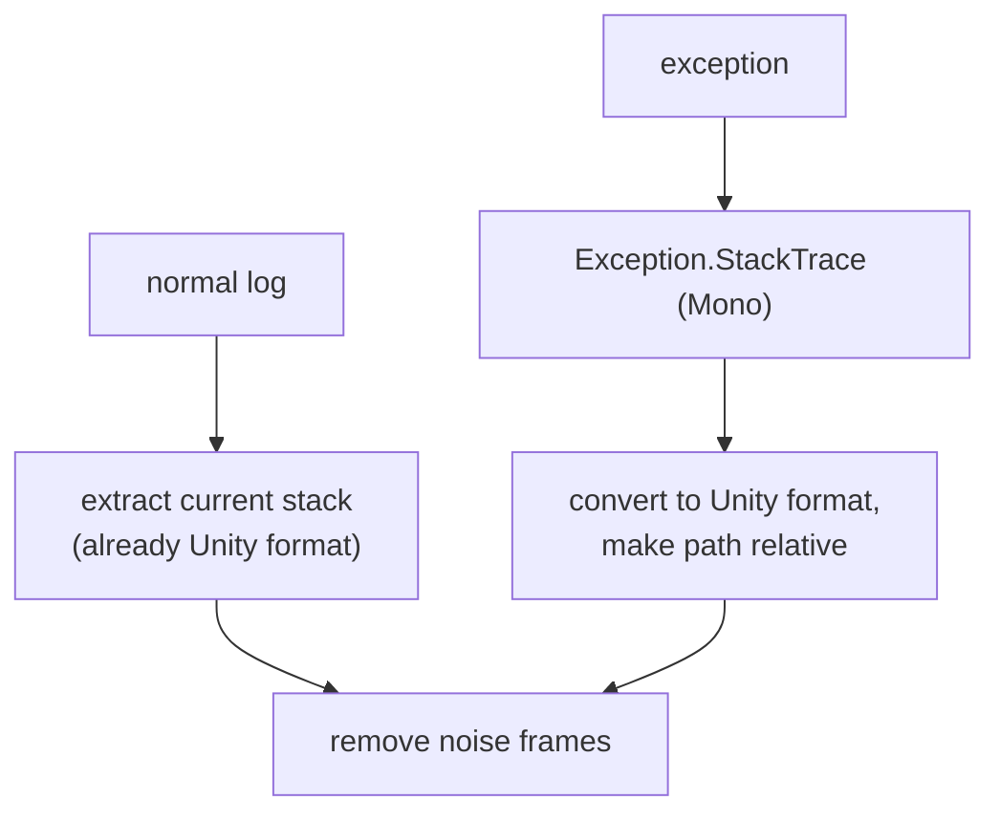
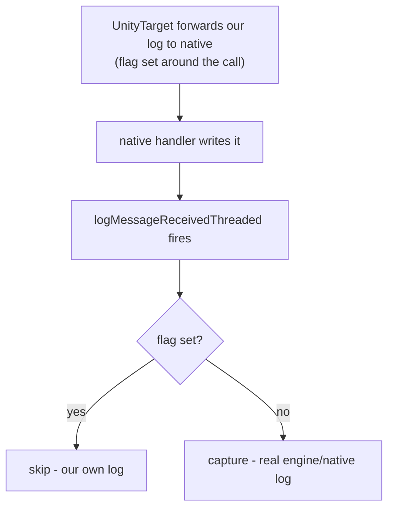

# UniLogger - Log Processing Pipeline

This document traces the life of a single log in UniLogger: from the call that creates it to the
moment it reaches a target (`Log` or `LogException`). Every box in the diagrams maps to real code.

---

## Table of contents

1. [Big picture](#1-big-picture)
2. [Logs: `SendLog`](#2-logs-sendlog)
3. [Exceptions: `DispatchException`](#3-exceptions-dispatchexception)
4. [Sync vs async and the writer thread](#4-sync-vs-async-and-the-writer-thread)
5. [Stack-trace handling](#5-stack-trace-handling)
6. [Recursion guard and the native feedback loop](#6-recursion-guard-and-the-native-feedback-loop)

---

## 1. Big picture

UniLogger takes over Unity's log handler in `Initialize()`. After that, every `Debug.Log*` and
`Debug.LogException` in the project goes through the same path as `ULogger` calls. UniLogger also
builds and cleans the call stack itself, so there is no extra trip through Unity to get it.

Each log goes to one of two kinds of target. **Sync** targets get the log at once, on the same
thread that logged it. **Async** targets go to a queue that one background thread writes out. A
target picks its kind with `RunSynchronously`.



Native and engine logs (not from `ULogger` or `Debug`) are caught by `logMessageReceivedThreaded`
and sent to the targets that accept native logs. Some targets opt out of these (see
[`targets.md`](targets.md)).

---

## 2. Logs: `SendLog`

`SendLog` is the main path for normal logs.



Key points:

- Before `Initialize()` there are no targets yet, so the log falls back to `Debug.unityLogger`.
  Nothing is lost at startup.
- The stack is captured **once**, and only if some target needs it for this level. All targets share
  that one string.
- Sync targets run on the calling thread, so a main-thread log stays on the main thread.
- Async targets get a copy of the log on the queue.
- Each target then applies its own filter and formatter before writing. See
  [`formatting-and-filtering.md`](formatting-and-filtering.md).

---

## 3. Exceptions: `DispatchException`

Exceptions take their own path. If the exception is an `AggregateException`, UniLogger flattens it
and logs **each inner exception as its own entry**, so each one keeps its real type, message, and
throw-site stack. A non-aggregate is logged as one entry. Each entry is formatted once (type,
message, clean stack) and sent straight to `target.LogException`. This path skips the per-target
filter and formatter, because an exception has no tags and is already a full text block.



So a `Task.WhenAll` that fails with three exceptions becomes three log entries, not one.

For the stack, UniLogger uses `Exception.StackTrace` when it is set (Mono format, which it converts),
or the current stack otherwise. Both go through the noise filter. See
[Stack-trace handling](#5-stack-trace-handling).

---

## 4. Sync vs async and the writer thread

A target is either sync or async (`RunSynchronously`). Sync targets get the log right away, on the
thread that logged it. Async targets go to a queue. One background thread, `UniLogger.Writer`, reads
the queue and writes to them.



- The thread takes one record, then also takes any others already waiting, and flushes once after the
  batch. This is fast and avoids a flush per line.
- On shutdown the queue closes, the thread writes what is left and flushes one last time, so nothing
  in the queue is lost.

---

## 5. Stack-trace handling

Two parts shape a stack, and both paths end by removing noise frames. Which parts run depends on the
path.



### Noise filtering (`RemoveNoiseFrames`)

This drops stack lines that only add noise, so the stack shows user code. It removes UniLogger's own
frames, Unity's logging frames, assertion frames, and async/thread machinery. Matching is by
fully-qualified prefix at a frame boundary, so a user type that only starts with the same text (for
example `Appegy.UniLogger.ULoggerFoo`) is kept. The exact prefix list lives in
[`StackTraceCleaner`](../src/Runtime/Internal/UnityInterop/StackTraceCleaner.cs).

### Mono to Unity conversion (exceptions only)

`Exception.StackTrace` is a Mono-format string. `new StackTrace(exception)` would lose the real throw
site across `await`, so UniLogger parses the string instead:

```
  at NS.Type.Method (args) [0x00000] in /proj/Assets/Foo.cs:23
        becomes
NS.Type:Method (args) (at Assets/Foo.cs:23)
```

The path is made relative to the project root. Frames outside the project keep the method name but
lose the file location. In a build the source paths do not match the device, so exception locations
are dropped there. This is expected.

---

## 6. Recursion guard and the native feedback loop

**Problem.** UniLogger listens to `Application.logMessageReceivedThreaded` to catch engine and native
logs, which never pass through our handler. In a player, though, `UnityTarget` writes our own logs to
that native handler, so they raise the same event and would be logged a second time.

**Solution.** UniLogger sets a `[ThreadStatic]` flag around the forward. When the event fires for our
own log the flag is set, so the listener skips it. A log without the flag is a real engine/native log
and is kept.



The flag is set and cleared in a `try/finally`, so it never stays stuck, and being `[ThreadStatic]`
it does not leak between threads.
